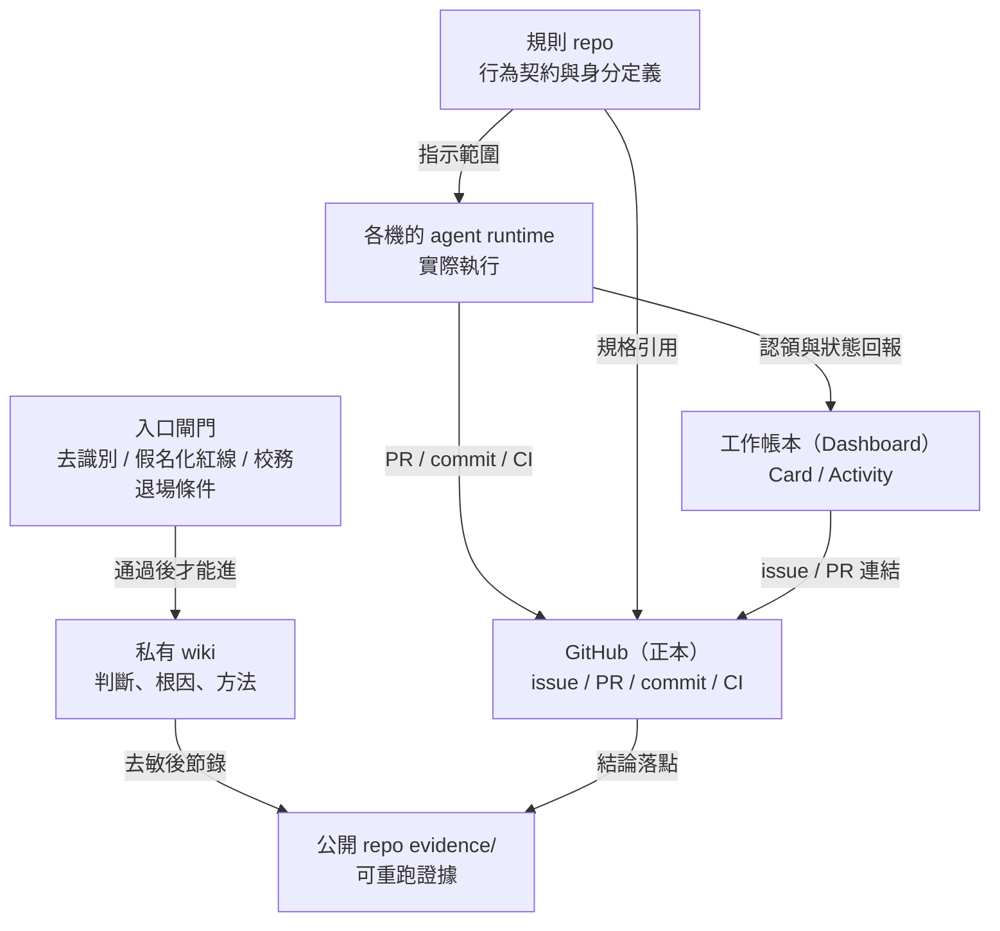

# 把整套系統畫成一張圖

## mermaid 原始檔

## 文字版重點

- 只有一個真相倉庫：GitHub。可交付結論必須落成 commit 或時間戳，否則不算完成。
- 規則答「誰在什麼條件下能做什麼」；runtime 答「誰現在真的在跑」；帳本答「誰在做、做到哪、由誰接」。
- 三個收納方向：結論往 GitHub、理解往 wiki、過程狀態往帳本。互不存副本。
- 紅線閘門設在入口，不設在出口：校務相關材料一進系統就分流，不可等到發布端才檢查。
